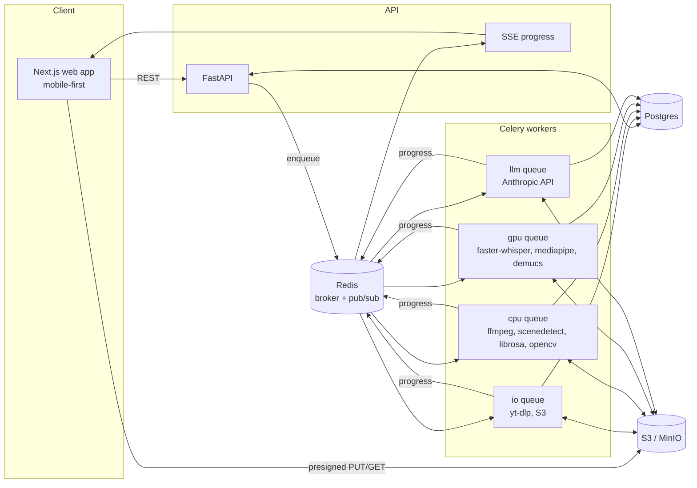

# Architecture — StyleCut

## System overview



## The three contracts

Everything flows through three versioned JSON documents. Modules communicate only through these:

```
StyleProfile  ──►  ShootPlan  ──►  Timeline  ──►  Renderer
 (analysis/)      (planning/)      (edit/)        (render/)
```

- **StyleProfile**: what the reference *does* (STYLE_PROFILE_SPEC.md)
- **ShootPlan**: what the user must *film* (PLAN_MODE_SPEC.md)
- **Timeline**: exactly what to *render* (EDIT_ENGINE_SPEC.md)

## Job DAGs

### Reference analysis
```
ingest_reference (io)
  └─► make_proxy (cpu)
        ├─► detect_scenes (cpu) ──────────┐
        ├─► analyze_audio (cpu) ──────────┤
        ├─► transcribe (gpu) ─────────────┤
        └─► analyze_color (cpu) ──────────┤
                                          ▼
                     build_contact_sheets (cpu)  [needs scenes]
                                          ▼
                           vision_breakdown (llm)
                                          ▼
                        synthesize_profile (llm)
                                          ▼
                     cleanup_reference_media (io)  [schedules deletion]
```
Use Celery `chord`/`group`. Each task writes its artifact to S3 and a row in `jobs`. The parent job's progress is the weighted sum of its children.

### Footage processing (per uploaded clip, in parallel)
```
make_proxy → [transcribe, face_track, quality_metrics] → coverage_classify (llm)
```

### Assembly
```
coverage_check → select_takes (llm) → jump_cuts → map_to_plan → pacing_pass
  → emphasis_pass (llm) → beat_sync → captions → audio_plan → Timeline v1 → render(preview)
```
Assembly passes are pure functions `Timeline -> Timeline` (except the LLM passes, which are wrapped so their outputs are cached). They live in `edit/passes/` and run in a fixed order defined in `edit/pipeline.py`.

## Storage layout (deterministic keys)

```
references/raw/{asset_id}.{ext}                 # expires 24h
references/proxy/{asset_id}.mp4                 # expires 24h
references/derived/{asset_id}/scenes.json
references/derived/{asset_id}/audio.json
references/derived/{asset_id}/transcript.json
references/derived/{asset_id}/color.json
references/derived/{asset_id}/sheets/{n}.jpg     # kept (low-res, for Style Card UI)
footage/{project_id}/{asset_id}/original.{ext}
footage/{project_id}/{asset_id}/proxy.mp4
footage/{project_id}/{asset_id}/speech.wav
footage/{project_id}/{asset_id}/transcript.json
footage/{project_id}/{asset_id}/faces.json
library/{user_id}/music/{asset_id}.{ext}
library/{user_id}/sfx/{asset_id}.{ext}
renders/{project_id}/segments/{segment_hash}.mp4   # segment cache, shared by all timeline versions of a project
renders/{timeline_id}/{preset}.mp4
```

## Progress events
Published on Redis channel `job:{id}`:
```json
{"job_id":"…","status":"running","progress":0.42,"step":"Reading captions","eta_s":18}
```
`GET /jobs/{id}/events` relays them as SSE. The web app uses one `useJob(id)` hook everywhere.

## LLM layer (`stylecut/llm/`)
- `client.py`: `call_structured(prompt_id, inputs, output_model, model=…, images=[…]) -> output_model`
  - Renders the prompt from the registry, defines a single tool whose `input_schema` is `output_model.model_json_schema()`, and forces tool use.
  - Validates with Pydantic and retries once with the validation errors.
  - Logs to `llm_calls` (prompt_id, version, model, input/output tokens, latency_ms, cost_usd, job_id).
- `prompts/`: one file per prompt with `ID`, `VERSION`, `SYSTEM`, `USER_TEMPLATE` (see PROMPTS.md).
- Caching: hash(prompt_id, version, model, inputs) → cached output in Postgres. Speeds up re-runs and tests.

## Performance targets
| Step | Target (30s clip) |
|---|---|
| Ingest + proxy | < 15s (target); < 30s is the Phase 1 acceptance bar |
| Full analysis | < 90s (GPU) |
| Shoot plan | < 20s |
| Auto-assemble (5 min of raw footage) | < 120s |
| Preview render | < 20s |
| Final render | < 60s |

## Scaling notes
- Run the GPU queue on separate autoscaled workers. CPU and LLM workers are cheap and horizontal.
- The segment cache makes editor re-renders incremental: only changed segments are re-encoded, then concat plus the caption/audio pass runs again.
- Use NVENC (`h264_nvenc`) on GPU workers for final renders if available; fall back to libx264 `-preset veryfast`.

## Security
- All S3 access is presigned and short-lived (15 min). Buckets are private.
- Ownership check middleware: every resource is resolved through `owner_id`.
- yt-dlp runs in the `io` worker container with no access to DB credentials beyond its job row (separate DB role). Downloads are capped at 200MB and 3 min.
